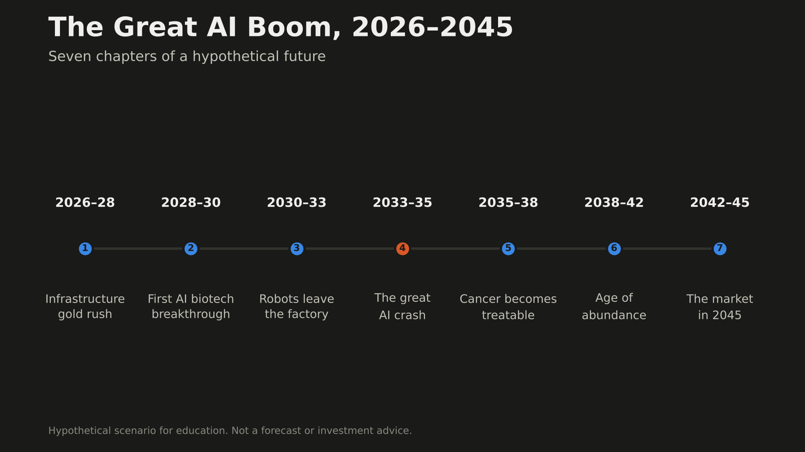
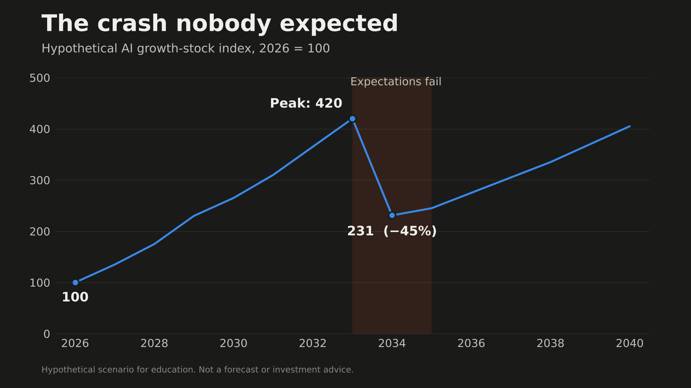
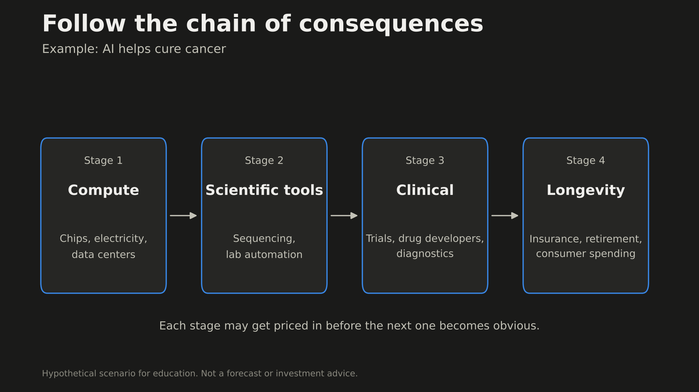
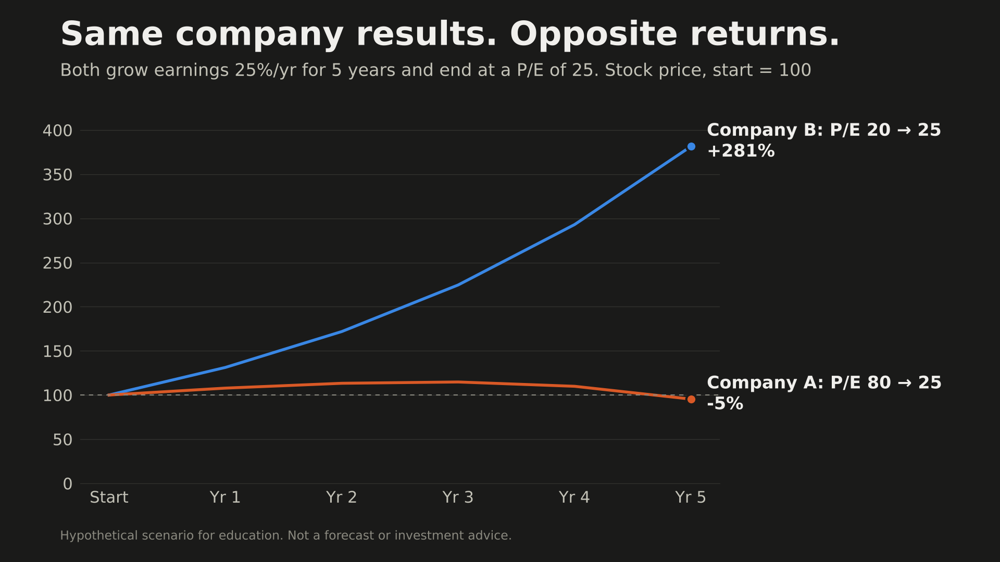
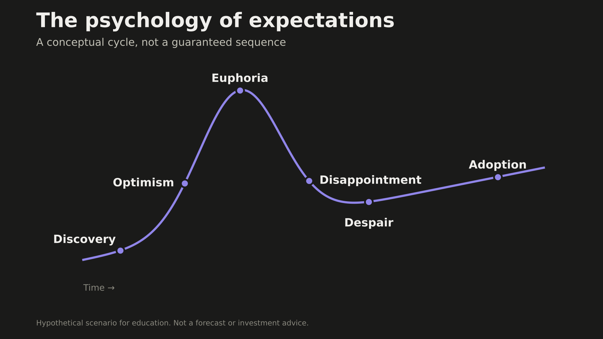

# The Great AI Boom: A Stock Market Story, 2026–2045

*A hypothetical future where AI, robotics, biotechnology, and abundance transform the global economy.*

> **Disclaimer:** This is a fictional, optimistic scenario for education. All dates, events, and market returns are illustrative. It is not a forecast or personal investment advice.

Imagine it's 2045.

Cancer is no longer the death sentence it once was. Robots handle much of the world's physical labor. AI has dramatically sped up scientific discovery. Energy is cheaper, manufacturing is more efficient, and people are living longer, healthier lives.

The stock market has created enormous fortunes along the way.

But some investors who correctly predicted this future still lost money. Others got rich investing in companies nobody was talking about when the revolution began.

**The central principle:** the stock market doesn't simply reward good news. It rewards outcomes that are *better than what investors already expected.*

---

## Chapter 1: The Infrastructure Gold Rush (2026–2028)

It's late 2026. AI models keep improving. Businesses race to automate work. Every major technology company wants more computing power.

Investors focus on Nvidia and Microsoft, but the physical world can't keep up. Data centers need electricity, transformers, cooling systems, optical fiber, and power-grid upgrades.

A relatively obscure electrical equipment maker announces that its order backlog has doubled. Institutional investors notice. Money starts rotating from the obvious AI winners into the companies *supplying* the AI economy.

**Market psychology**
- First: *"AI is the future. I need to own the companies making AI."*
- Then: *"Every AI company needs electricity and infrastructure. Who supplies those?"*

**Companies worth researching**

| Ticker | Company | Role |
|---|---|---|
| ETN | Eaton | Electrical infrastructure |
| VRT | Vertiv | Data center power and cooling |
| GLW | Corning | Optical fiber and materials |
| GEV | GE Vernova | Power generation and grid equipment |

**Lesson:** The early opportunity may be finding the bottlenecks AI creates before everyone else prices them in.

---

## Chapter 2: The First AI Biotech Breakthrough (2028–2030)

It's 2029. A biotech company announces remarkable late-stage results for an AI-assisted cancer treatment. Its stock jumps 70% in one day. Financial news celebrates. Investors rush into AI drug discovery.

Six months later, another company's trial fails. Several speculative biotech stocks collapse 40–60%.

The science keeps moving forward, but the market swings through euphoria, disappointment, and consolidation.

**Market psychology:** A revolutionary industry is not necessarily a profitable investment. Investors often overestimate short-term progress and underestimate long-term change.

| Ticker | Company | Role |
|---|---|---|
| TMO | Thermo Fisher Scientific | Lab equipment and research services |
| DHR | Danaher | Life-science tools |
| ILMN | Illumina | DNA sequencing |
| RXRX | Recursion Pharmaceuticals | Speculative AI-driven drug discovery |

**Lesson:** Companies supplying research infrastructure may benefit from more experimentation even when individual drugs fail. But they can still be overpriced.

---

## Chapter 3: Robots Leave the Factory (2030–2033)

It's 2031. Humanoid robots become commercially practical for a wider range of repetitive factory and logistics work. An early adopter announces big cost savings. Competitors must automate or fall behind.

Robot orders surge. Investors chase robot makers, but competition heats up, robot prices fall, and some manufacturers struggle to protect margins. Meanwhile, component suppliers and businesses that *use* robots well enjoy stronger economics.

**Market psychology:** The company that invents a revolutionary technology does not necessarily capture most of its value.

| Ticker | Company | Role |
|---|---|---|
| ROK | Rockwell Automation | Industrial automation |
| ABB | ABB | Robotics and electrification |
| TER | Teradyne | Automation and testing |
| CGNX | Cognex | Machine vision |

**Lesson:** Follow the businesses that supply, deploy, and profit from automation, not just those that build the robots.

The social consequences are complex. Productivity grows, but some workers are displaced. Governments debate retraining, income support, and taxation.

---

## Chapter 4: The Great AI Market Crash (2033–2035)

It's 2033. AI is better than ever. Robotics is expanding. Biotech is advancing.

Yet a hypothetical Nasdaq crash sends the index down 45%.

Why? **Investors had priced in near-perfect outcomes.** Companies spent billions on infrastructure, and some of it delivered disappointing returns. Competition cut prices for AI services. Heavily indebted businesses struggled. Even successful companies couldn't grow fast enough to justify their valuations.

*The technology wasn't failing. Expectations were.*

**Market psychology:** A company can perform well as a business while its stock performs terribly. Investors who buy at euphoric valuations can suffer huge losses. Investors who study fundamentals during pessimistic periods may find better opportunities.

**Lesson:** Predicting the future correctly isn't enough. The purchase price matters enormously.

---

## Chapter 5: Cancer Becomes Increasingly Treatable (2035–2038)

It's 2036. AI-designed treatments, immunotherapies, early detection, and gene technologies dramatically improve outcomes for many cancers. Millions of people live longer, healthier lives.

Investors first focus on drug companies. Then analysts ask bigger questions:

- What happens when people live 10–15 years longer?
- What happens when older adults stay economically active?
- What happens to retirement, travel, insurance, and consumer spending?

**Potential beneficiaries:** diagnostics and medical imaging; retirement and wealth management; travel and leisure; fitness and healthy-aging services; consumer businesses serving older people.

**Potentially disrupted:** certain chronic-disease treatment models; some insurers facing unexpected longevity costs; companies tied to medical technologies that become obsolete.

**Lesson:** Think beyond the breakthrough. Figure out what happens when the breakthrough becomes normal.

---

## Chapter 6: The Age of Abundance (2038–2042)

It's 2040. Robots build buildings more cheaply. AI improves industrial processes. Automated farming increases output. Some forms of energy get much cheaper. Productivity surges.

But consider an automated manufacturer that cuts production costs by 60%. If competitors make the same improvements, competition may force everyone to lower prices. **Consumers capture much of the value instead of shareholders.**

**Market psychology:** Productivity growth doesn't automatically turn into corporate profits or rising stock prices.

**What stays scarce:** desirable land and locations; reliable energy infrastructure; trusted brands and distribution; proprietary intellectual property; unique customer relationships.

**Lesson:** Look for companies that keep pricing power when technology makes production cheaper.

Abundance may also be shared unequally. Ownership, regulation, housing shortages, and job displacement can keep progress from reaching everyone equally.

---

## Chapter 7: The Market in 2045 (2042–2045)

AI is an ordinary part of economic life. Robots are everywhere. Biotech has transformed medicine.

Some celebrated AI companies from 2026 have disappeared, merged, or become mediocre investments. Others have grown into enormous, profitable enterprises.

Several of the biggest long-term winners barely marketed themselves as AI businesses. They simply supplied what the new economy couldn't function without.

**Lesson:** The best investors didn't necessarily predict the most inventions. They understood where profits would pile up, how much growth was already priced in, and when expectations became unreasonable.

---

# The Investing Playbook

## 1. Follow the chain of consequences

Example: AI helps cure cancer.

1. **Compute:** chips, electricity, data centers.
2. **Scientific tools:** sequencing, lab automation.
3. **Clinical:** trials, drug developers, diagnostics.
4. **Longevity:** insurance, retirement, consumer spending.

Each stage may offer opportunities before the next becomes obvious. But the timeline is uncertain, and some breakthroughs may never arrive.

## 2. A good company is not the same as a good stock

Imagine two companies that both grow earnings 25% a year for five years.

- **Company A** starts at a price-to-earnings (P/E) ratio of 80.
- **Company B** starts at a P/E of 20.
- Both finish at a P/E of 25.

Ignoring dividends and dilution:

| | Start P/E | End P/E | Earnings growth (5 yrs) | Price return |
|---|---|---|---|---|
| Company A | 80 | 25 | ×3.05 | **about −5%** |
| Company B | 20 | 25 | ×3.05 | **about +281%** |

*How it's calculated:* price return = (end P/E ÷ start P/E) × earnings growth − 1. Earnings growth is 1.25⁵ ≈ 3.05. Company A: (25 ÷ 80) × 3.05 ≈ 0.95, so about −5%. Company B: (25 ÷ 20) × 3.05 ≈ 3.81, so about +281%.

Identical business results. The only difference was the price investors paid at the start.

## 3. Build an early-signal watchlist

| Theme | Tickers | What to watch |
|---|---|---|
| AI infrastructure | ETN, VRT, GLW | Power demand, order backlogs, construction, grid investment |
| AI biotech | RXRX, TMO, DHR | Clinical results, research budgets, lab automation |
| Robotics | TER, ABB, ROK | Deployments, falling automation costs, customer ROI |
| Precision medicine | ILMN, ISRG | Clinical adoption, procedure growth |
| Energy | GEV, CEG | Power contracts, capacity additions, infrastructure spending |
| Longevity economy | V, BLK | Demographics, consumer spending, savings, retirement |

These are companies to research, not automatic buys. Valuation, competition, balance sheets, and execution still matter.

## 4. Learn the psychology of expectations

1. **Discovery:** investors start noticing a new opportunity.
2. **Optimism:** early wins attract money.
3. **Euphoria:** extraordinary outcomes are assumed to be inevitable.
4. **Disappointment:** growth misses inflated expectations.
5. **Despair:** investors abandon the theme.
6. **Adoption:** real-world use continues and lasting businesses emerge.

It's a conceptual cycle, not a guaranteed sequence.

## 5. Ask the second-order question

Instead of asking *"Which company will invent the next revolutionary technology?"*, ask:

> **"If this technology becomes 100 times more useful, what will the world suddenly need 10 times more of, and who can supply it profitably?"**

Then ask: *"How much of that future demand is already in the stock price?"*

## 6. Look for three signals

- **Bottlenecks:** Which essential resources or services are becoming scarce?
- **Adoption inflection points:** When does a technology go from experimental to economically practical?
- **Valuation extremes:** When are investors assuming unrealistic success, or excessive failure?

---

## Final thought

The most important investing skill may not be predicting the next breakthrough. It may be understanding how breakthroughs change demand, costs, competition, profits, and human expectations.

A technology can transform civilization while its investors lose money. An ordinary-looking supplier can quietly become one of the biggest winners of a revolution.

The goal isn't simply to find the future. It's to understand which businesses can capture its value, and to avoid paying a price that already assumes everything goes perfectly.

*Prefer to watch? The video version is on YouTube: [link]*

---

*Disclaimer: All dates, events, and hypothetical market returns are illustrative. This is an educational scenario, not a prediction or personalized investment recommendation. Do your own research or consult a licensed financial professional before investing.*
